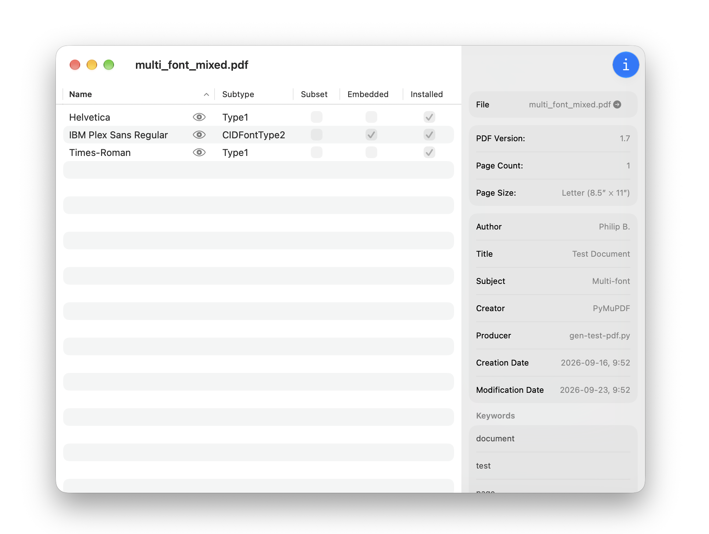

# PDF Info

<!-- TODO: Update -->
PDF Info is a small, native macOS app for inspecting PDF fonts and metadata.



## License

[MIT License](https://github.com/philipbel/PDFInfo/tree/master?tab=MIT-1-ov-file)


## Installation

### macOS

There are two ways to install PDF Info:

1. From GitHub: download a disk image (`.dmg` file) with the latest
   version from [GitHub](https://github.com/philipbel/PDFInfo/releases).

2. Install via Homebrew:

    a) First add the [philipbel/tap](https://github.com/philipbel/homebrew-tap) tap
      ```bash
      brew tap philipbel/tap
      brew trust philipbel/tap
      ```
   b) install the cask:
      ```bash
      brew install --cask pdfinfo
      ```


## Development

1. Install the requirements for your OS/environment.
2. Create a Python virtual environment:
   ```
   uv venv --python 3.14
   ```
3. Activate it
   ```
   source .venv/bin/activate
   ```
4. Install Python dependencies
   ```
   uv sync
   ```
5. Build external dependencies (installed into `build/prefix/`):
   ```
   ./etc/make-deps.py
   ```


Once you have a rust toolchain (see below for platform-specific instructions):
- ```rustup toolchain install nightly --component rustfmt```
- ```rustup component add clippy``` 


### macOS Requirements

1. macOS 14 Sonoma or later, Intel or Apple Silicon.
2. Xcode
3. Rust:
   ```
   brew install rustup
   ```
4. uv (for generating test PDF files and to install CMake and Ninja):
   ```
   brew install uv
   ```
5. For making releases:

   5.1. GitHub:
     ```
     brew install gh
     ```

   5.2 create-dmg:
    ```
    brew install create-dmg
    ```

Tested on macOS 27 Golden Gate with Apple Silicon. Please file an
[issue](https://github.com/philipbel/PDFInfo/issues/new/choose) if the app
doesn't work for you.

### Gtk (macOS) Requirements

1. Gtk4 + Adwaita:
   ```
   brew install gtk4 libadwaita adwaita-icon-theme
   ```
2. pkg-config:
   ```
   brew install pkg-config
   ```
3. uv:
   ```
   brew install uv
   ```
4. LLVM
   ```
   brew install llvm
   ```
5. gettext
   ```
   brew install gettext
   ```

### Gtk (Linux) Requirements

TODO:


### Windows
TODO:
1. Rust, for example using rustup via winget:
   ```
   winget install Rustlang.Rustup
   ```
3. Microsoft's C++ compiler
   ```
   winget install Microsoft.VisualStudio.BuildTools
   ```
   Once installed, launch the Visual Studio Installer, go to Modify, and install "Desktop development with C++". You
   can skip "C++ CMake tools for Windows".

3. LLVM (for bindgen)
   ```
   winget install LLVM.LLVM
   ```
